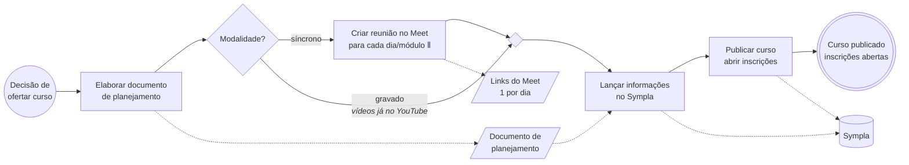

# 01 — Criação e publicação de curso (AS-IS)

Diagrama BPMN: [`01-criacao-e-publicacao-de-curso.bpmn`](./01-criacao-e-publicacao-de-curso.bpmn)
(abrir em <https://demo.bpmn.io> ou Camunda Modeler)

## Ficha do processo

| Item | Descrição |
|---|---|
| **Objetivo** | Disponibilizar um novo curso para inscrição dos alunos |
| **Evento de início** | Decisão de ofertar um novo curso |
| **Evento de fim** | Curso publicado no Sympla com inscrições abertas |
| **Atores** | Coordenação de cursos *(hipótese — a confirmar quem faz cada passo)* |
| **Sistemas** | Sympla; Google Meet (síncrono); YouTube (gravado — pré-condição) |
| **Artefatos** | Documento de planejamento do curso; links do Meet (1 por dia/módulo) |
| **Frequência / duração** | *a levantar* |

## Fluxo (prévia)

## Documento de planejamento — campos

| Campo | Observação |
|---|---|
| Conteúdo | |
| Cronograma | |
| Carga horária | |
| Datas do curso | |
| Quantidade de alunos | Se `síncrono`: limitada ao nº máx. de participantes do plano pago do Google Meet |
| Valor da matrícula | **sempre fixo** (não varia por modalidade, lote ou desconto) |
| Modalidade | `gravado` ou `síncrono` — **altera o processo de liberação de acesso** (ver [02](./02-liberacao-de-acesso-ao-curso.md)) |
| Período de inscrição | início e fim das inscrições |

## Regras de negócio

- **RN-01.1** — O valor da matrícula é fixo por curso (sem lotes, descontos ou variação por modalidade).
- **RN-01.2** — Em cursos síncronos, a quantidade de alunos não pode exceder o limite de participantes por reunião do plano pago do Google Meet.
- **RN-01.3** — Um curso tem 1 ou N módulos. Síncrono: uma reunião do Meet por dia; gravado: um vídeo não listado no YouTube por módulo.
- **Pré-condição (gravado)** — Os vídeos já existem no YouTube antes da publicação no Sympla; a produção do vídeo não faz parte deste processo.

## Dúvidas abertas (levar ao cliente)

1. **Quem** elabora o planejamento e **quem** lança no Sympla? É a mesma pessoa? Existe aprovação de alguém antes de publicar?
2. O documento de planejamento é um **template** fixo (Word, Google Docs, planilha)? Onde fica guardado?
3. ~~A modalidade muda o processo?~~ **Respondido:** gravado → vídeos já estão no YouTube; síncrono → criam reuniões do Meet (uma por dia). Ainda em aberto: as reuniões do Meet são criadas **antes** de lançar no Sympla, depois de publicar, ou só perto do início do curso?
4. A publicação é feita **na hora** do cadastro ou o Sympla é configurado para abrir inscrições **automaticamente** na data de início do período de inscrição?
5. O que acontece quando algo é cadastrado errado no Sympla depois de publicado (data, valor)? Edita direto? Cancela e recria?
6. A **quantidade de alunos** vira limite de ingressos no Sympla? O que acontece ao esgotar?
7. Depois de publicado, o curso é divulgado em algum canal (redes sociais, e-mail, WhatsApp)? Isso faz parte deste processo ou é outro (marketing)?
8. Os cursos se **repetem** (novas turmas do mesmo curso)? Se sim, o planejamento é feito do zero ou reaproveitado?
9. Quanto tempo leva, em média, do planejamento até a publicação? Quantos cursos são publicados por mês?
