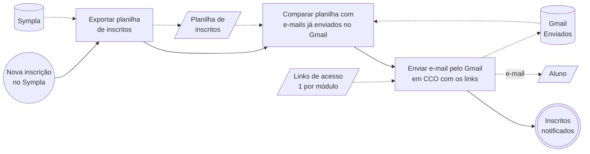

# 02 — Liberação de acesso ao curso (AS-IS)

Diagrama BPMN: [`02-liberacao-de-acesso-ao-curso.bpmn`](./02-liberacao-de-acesso-ao-curso.bpmn)

## Ficha do processo

| Item | Descrição |
|---|---|
| **Objetivo** | Entregar aos alunos inscritos o link de acesso ao conteúdo do curso |
| **Evento de início** | Nova inscrição registrada no Sympla *(como a coordenação fica sabendo: a confirmar)* |
| **Evento de fim** | Inscritos notificados por e-mail com o link de acesso |
| **Atores** | Coordenação de cursos *(a confirmar)*; Aluno inscrito (participante externo) |
| **Sistemas** | Sympla (exportação de planilha de inscritos), Gmail (envio em CCO), YouTube (gravado), Google Meet (síncrono) |
| **Artefatos** | Planilha de inscritos exportada do Sympla; links de acesso do curso (1 por módulo: vídeo não listado ou reunião do Meet) — já existem antes das inscrições |
| **Frequência** | A cada inscrição (ou lote de inscrições) |

## Fluxo (prévia)

## Regras de negócio

- **RN-02.1** — O link de acesso é enviado ao e-mail cadastrado pelo aluno no Sympla, a cada nova inscrição.
- **RN-02.2** — Curso *gravado*: acesso por links de vídeo **não listado** no YouTube, um por módulo (quem tem o link acessa; não há controle individual de acesso).
- **RN-02.3** — Curso *síncrono*: acesso por links do Google Meet, um por dia; a conta é paga e o nº de participantes por reunião segue o plano contratado.
- **RN-02.4** — O envio é feito manualmente pelo Gmail, com os destinatários em cópia oculta (CCO).
- **RN-02.5** — Não existe controle de quem já recebeu o link; a única evidência são os e-mails na caixa "Enviados" do Gmail.

## Observações do analista

- Os links já existem quando as inscrições começam (criados/pré-existentes no processo 01), então este processo não bifurca por modalidade — só o conteúdo do e-mail muda.
- Identificar quem ainda não recebeu depende de **comparar manualmente** a planilha do Sympla com a caixa "Enviados" do Gmail. Sem registro próprio → risco de envio duplicado ou aluno esquecido; cresce com o nº de inscritos e de cursos simultâneos.
- "Enviado" ≠ "recebido": não há confirmação de entrega/leitura.
- Link não listado do YouTube não expira nem é revogável por aluno: um inscrito pode repassar. Ponto de dor potencial para o to-be.

## Dúvidas abertas (levar ao cliente)

1. **Gatilho:** como a coordenação fica sabendo que houve nova inscrição? E-mail de notificação do Sympla? Consulta o painel de tempos em tempos (diariamente)?
2. **Lote × unitário:** o e-mail sai a cada inscrição individual ou juntam várias inscrições e enviam de uma vez em CCO?
3. **Vários módulos:** todos os links vão no **mesmo e-mail** na inscrição, ou é enviado um e-mail por dia/módulo (ex.: link do Meet na véspera de cada aula)? Se for por dia, este processo se repete N vezes por curso e o gatilho muda.
4. Existe um **template** do e-mail? Muda conforme a modalidade?
5. Quem cria as reuniões do Meet — coordenação ou instrutor? Qual o plano e o nº máx. de participantes?
6. **Exceções:** aluno diz que não recebeu; e-mail cadastrado errado; inscrição depois do início do curso; inscrições acima do limite do Meet. Como resolvem hoje?
7. Aluno que se inscreveu mas **não pagou** aparece na planilha? Recebe o link? Como o Sympla sinaliza pagamento?
8. Já aconteceu de enviar duas vezes para o mesmo aluno ou esquecer alguém? Com que frequência?
~~Momento do link / um ou vários links~~ — **respondido:** links já existem antes das inscrições; 1 por módulo (Meet por dia, vídeo por módulo).
