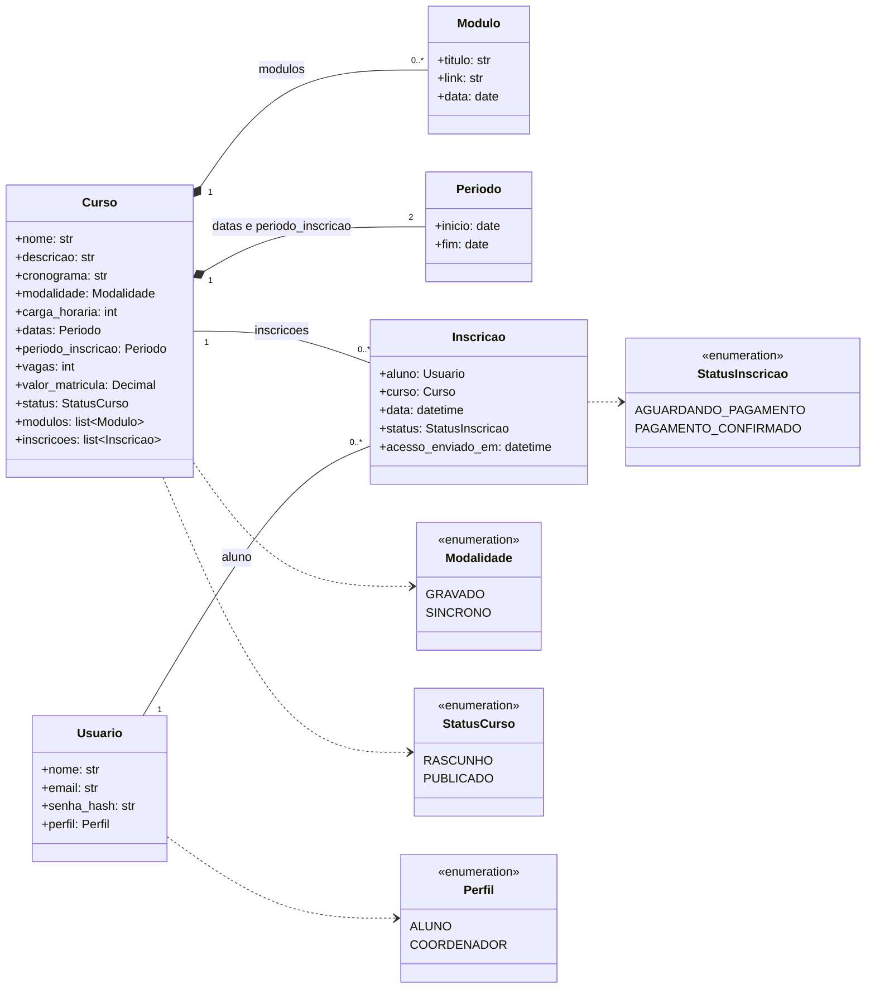

# Passo 2 — Filtrar os candidatos

[← Passo 1](01-substantivos-e-verbos.md) · [Projeto da v1](README.md) · próximo: [Passo 3 — Dar cada regra a um dono](03-responsabilidades.md)

Nem todo substantivo vira classe. Para cada candidato do [passo 1](01-substantivos-e-verbos.md), perguntamos:

1. **É coisa do domínio ou é tela/ferramenta?** "Painel", "lista" e "sessão" são da interface; "Google Meet" e "YouTube" ficam fora do sistema (ver a tabela de ferramentas em [`historias/README.md`](../requisitos/historias/README.md)).
2. **É sinônimo de outro candidato?** Então funde.
3. **Tem dados e regras próprios, ou é só um valor?** Se é só um valor, vira atributo.
4. **Aparece mais de uma vez com a mesma regra?** Então merece ser um bloco próprio.

## Decisões

| Candidato | Decisão | Por quê |
|---|---|---|
| curso | **classe `Curso`** | Centro de US-01 a 03 e 06; tem dados e regras (datas, vagas, publicação) |
| módulo | **classe `Modulo`**, parte de `Curso` | Tem dados próprios (título, data, link), mas não existe sem um curso (US-02: "módulos de um curso") |
| inscrição · inscrito · matrícula | **classe `Inscricao`** (fundidos) | Três nomes para a mesma coisa: o glossário define matrícula como "inscrição paga", e "inscrito" é o aluno visto pela inscrição (US-08) |
| aluno · coordenador · conta · perfil | **classe `Usuario`** + **enum `Perfil`** | US-05 usa o mesmo login para os dois; o que muda é o perfil. "Conta" é o próprio usuário (US-04) |
| datas do curso · período de inscrição | **classe `Periodo`** | Aparecem duas vezes com a mesma regra: fim não antes do início (US-01 c3). Um bloco, duas instâncias |
| modalidade | **enum `Modalidade`** | Só dois valores: gravado, síncrono |
| rascunho · publicado | **enum `StatusCurso`** | Estados do curso (US-01 c1, US-03 c1) |
| aguardando pagamento · pagamento confirmado | **enum `StatusInscricao`** | Estados da inscrição (US-07 c1, US-08 c2) |
| pagamento | **não é classe** | D-01: o pagamento acontece fora do sistema. O que o sistema guarda é o **estado** da inscrição |
| vaga | **atributo** `vagas` de `Curso` | É um número; as vagas ocupadas são **calculadas** (passo 3) |
| valor da matrícula | **atributo** `valor_matricula: Decimal` | Dinheiro não é `float` (lembra da aula de abertura?) |
| link de acesso | **atributo** `link` de `Modulo` | É uma URL do Meet ou do YouTube; as ferramentas ficam fora |
| e-mail de acesso enviado (e quando) | **atributo** `acesso_enviado_em` de `Inscricao` | Substitui a conferência na caixa "Enviados" do Gmail (RN-02.5) |
| e-mail de acesso · instruções de pagamento | **não é classe do domínio** | É mensagem; quem envia é uma interface de e-mail, desenhada no passo 4 |
| chave Pix | **fora do domínio, por ora** | *(a confirmar, US-07 c2)*: se for uma chave única do cliente, é configuração do sistema |
| nome, descrição, cronograma, carga horária, título, data, e-mail, senha, data da inscrição | **atributos** | São valores das classes acima |
| área do aluno · "Meus cursos" · painel · lista · detalhes · campo · sessão | **fora do domínio** | Interface e autenticação: entram na camada do FastAPI (passo 5) |

## O diagrama de classes (estrutura)

Por enquanto só **atributos e relações**. Os métodos entram no [passo 3](03-responsabilidades.md).

### Como ler

- **◆ composição** (`Curso` ◆— `Modulo`, `Curso` ◆— `Periodo`): a parte não existe sem o todo. Apagou o curso, foram-se os módulos.
- **— associação** (`Curso` — `Inscricao` — `Usuario`): a inscrição **liga** um aluno a um curso. Um aluno tem várias inscrições (uma por curso); um curso tem várias inscrições.
- **números nas pontas** (multiplicidade): `1` e `0..*` dizem quantos de cada lado.
- **opcionais**: `cronograma` (US-01, campo não obrigatório), `Modulo.data` (só no síncrono, US-02) e `acesso_enviado_em` (vazio até o e-mail sair) podem ficar sem valor. No código, `X | None`.

## Pontos que este passo deixou abertos

- **Um curso pode ter zero módulos?** A RN-01.3 diz "1 ou N módulos", mas a US-03 c4 permite publicar sem módulo, que seriam cadastrados depois *(a confirmar)*. O diagrama usa `0..*` para seguir a história. Se o cliente confirmar a RN, quem impõe é o `publicar()` (passo 3).
- **O curso tem um coordenador dono?** Nenhuma história diz isso. Na v1, qualquer coordenador gerencia qualquer curso *(a confirmar)*. Por isso não há ligação entre `Curso` e `Usuario`.
