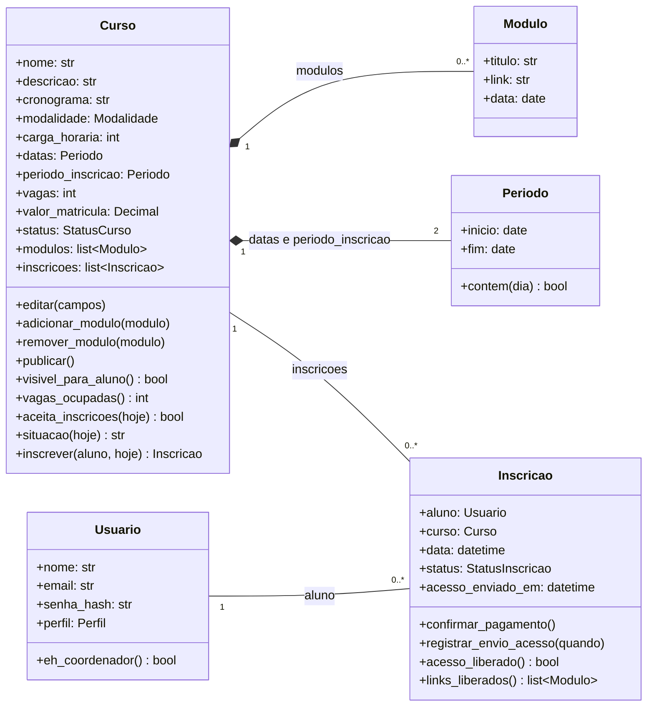
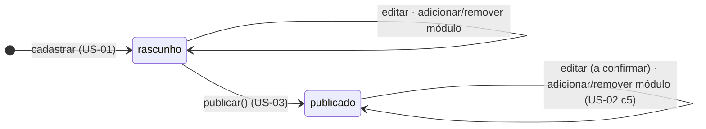
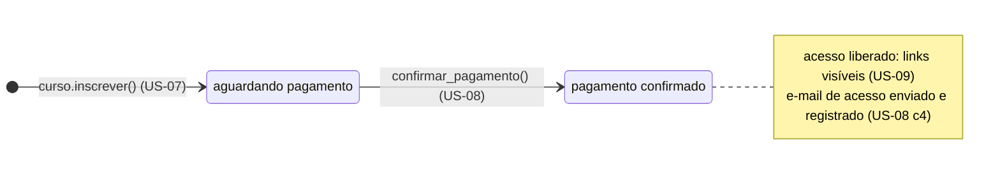

# Passo 3 — Dar cada regra a um dono

[← Passo 2](02-classes.md) · [Projeto da v1](README.md) · próximo: Passo 4 — Desenhar a conversa entre os objetos *(a fazer)*

## A regra deste passo

> "o estado de um sistema é descentralizado entre os objetos que compõem o sistema, ou seja, cada objeto manipula seu próprio estado"
> — Vasconcelos et al., 2006, p. 64

Na prática: **a regra mora com quem tem o dado.** Para cada critério de aceitação, perguntamos que objeto tem as informações necessárias para decidir.

- Se **um** objeto tem tudo, a regra vira um método dele.
- Se a regra precisa de dados que **nenhum** objeto tem sozinho (por exemplo, "todos os usuários"), ela não é do domínio. Vai para um serviço ou para a API (passo 5).

Quando uma regra é violada, o método **recusa**: lança um erro do domínio (ex.: `InscricaoDuplicada`). Quem traduz o erro numa resposta HTTP é a camada do FastAPI, não a classe.

## Critério por critério

### `Periodo`

| Critério | Regra | Método |
|---|---|---|
| US-01 c3 | Data final não pode ser anterior à inicial | validação ao criar |
| US-03 c2 · US-07 c4 | Saber se uma data cai dentro do período | `contem(dia)` |

### `Curso`

| Critério | Regra | Método |
|---|---|---|
| US-01 c1 | Curso novo nasce em **rascunho** | validação ao criar |
| US-01 c2 | Campos obrigatórios preenchidos | validação ao criar |
| US-01 c3 | Período de inscrição não termina depois do fim do curso | validação ao criar |
| US-01 c5 · RN-01.2 | Síncrono: vagas ≤ limite do Meet *(a confirmar: o limite)* | validação ao criar |
| US-01 c4 · US-03 c3 | Editar revalida tudo *(a confirmar: o que pode mudar depois de publicado)* | `editar(...)` |
| US-02 c1 | Módulo passa a fazer parte do curso | `adicionar_modulo(modulo)` |
| US-02 c3 | Síncrono: módulo com data, dentro das datas do curso | `adicionar_modulo(modulo)` |
| US-02 c2 | Editar ou remover módulo | `remover_modulo(modulo)` |
| US-03 c1 | Só publica o que está em rascunho e válido | `publicar()` |
| US-03 c2 · US-07 c4 | Aceita inscrição: publicado, dentro do período e com vaga | `aceita_inscricoes(hoje)` |
| US-07 c5 | Quantas vagas estão ocupadas *(a confirmar: conta na inscrição ou só na confirmação?)* | `vagas_ocupadas()` |
| US-06 c4 | "inscrições abertas", "inscrições encerradas" ou "esgotado" | `situacao(hoje)` |
| US-06 c3 | Rascunho nunca aparece para o aluno | `visivel_para_aluno()` |
| US-07 c1 | Inscrição nasce **aguardando pagamento** | `inscrever(aluno, hoje)` |
| US-07 c3 | Aluno já inscrito não gera segunda inscrição | `inscrever(aluno, hoje)` |
| US-08 c1 | Ver os inscritos do curso | atributo `inscricoes` |

Por que `inscrever` é de `Curso`, e não de `Inscricao` ou de `Usuario`? Porque, para decidir, é preciso saber o status, o período, as vagas **e quem já se inscreveu**. Só o curso tem tudo isso.

### `Modulo`

| Critério | Regra | Método |
|---|---|---|
| US-02 c4 | Link precisa ser uma URL | validação ao criar |

### `Inscricao`

| Critério | Regra | Método |
|---|---|---|
| US-08 c2 | Confirmar muda o status para **pagamento confirmado** | `confirmar_pagamento()` |
| US-08 c3 | Não confirma duas vezes | `confirmar_pagamento()` |
| US-08 c4 | Registra se e quando o e-mail de acesso saiu | `registrar_envio_acesso(quando)` |
| US-08 c2 · US-09 c2 · US-09 c3 | Links só depois da confirmação | `acesso_liberado()` · `links_liberados()` |
| US-09 c4 | Links sempre atualizados | `links_liberados()` lê os módulos **do curso** na hora, em vez de guardar uma cópia |

O US-09 c4 sai de graça do desenho: como a inscrição não copia os links, não existe "link desatualizado".

### `Usuario`

| Critério | Regra | Método |
|---|---|---|
| US-04 c3 | E-mail em formato válido | validação ao criar |
| US-05 c1 | Saber se é aluno ou coordenador | `eh_coordenador()` |

## Regras sem dono no domínio

Estas regras precisam de algo que nenhum objeto tem sozinho. Ficam anotadas para o passo 5:

| Critério | Regra | Por que não é do domínio | Onde vai |
|---|---|---|---|
| US-04 c2 | E-mail único no sistema | Precisa conhecer **todos** os usuários | serviço + repositório |
| US-04 c1 · US-05 c1–c3 | Senha, login, sessão, mensagem genérica de erro | Segurança e sessão são da aplicação web | API (FastAPI) |
| US-01 a 03 · US-08 | Só coordenador cadastra, publica e confirma | Depende de quem está logado | API (FastAPI) |
| US-06 c1–c2 | Listar e detalhar cursos **sem os links** | É uma regra sobre o que **mostrar** | API (schema de resposta sem link) |
| US-09 c1 | "Meus cursos" do aluno logado | Consulta por aluno, cruzando cursos | serviço + repositório |
| US-07 c2 | Mostrar e enviar as instruções de pagamento | Envio de e-mail; chave Pix *(a confirmar)* | serviço + e-mail (passo 4) |
| US-08 c2 | Enviar o e-mail com os links | Envio de e-mail | serviço + e-mail (passo 4) |

No US-08 c2, a parte de regra (mudar o status, liberar o acesso) é da `Inscricao`. Só o **envio** é de fora. O serviço faz `confirmar_pagamento()` → envia → `registrar_envio_acesso(agora)`. É a primeira conversa a desenhar no passo 4.

## O diagrama de classes, agora com métodos



Os enums (`Modalidade`, `StatusCurso`, `StatusInscricao`, `Perfil`) estão no [passo 2](02-classes.md) e foram omitidos aqui para o diagrama caber na tela.

## Os estados

Os estados em negrito do [passo 1](01-substantivos-e-verbos.md) viram diagramas de estado: o que pode acontecer com cada objeto, e em que ordem.

### Curso



Não há volta de **publicado** para **rascunho**: nenhuma história pede "despublicar".

### Inscrição



- Confirmar de novo não faz nada novo: é recusado (US-08 c3).
- **Desfazer** a confirmação (voltar a "aguardando") *(a confirmar, US-08 c5)*: se o cliente quiser, é uma seta nova e um método novo em `Inscricao`; nada mais muda.

## Do critério ao teste

Cada linha das tabelas acima vira **pelo menos um teste de unidade**, com o critério no nome. Isso deixa a rastreabilidade completa: história → critério → método → teste.

```python
def test_us07_c3_aluno_ja_inscrito_nao_gera_segunda_inscricao(): ...
def test_us08_c3_pagamento_ja_confirmado_nao_confirma_de_novo(): ...
def test_us09_c3_inscricao_aguardando_nao_mostra_links(): ...
```

Se um critério não tem teste, ele não foi verificado. Se um teste não aponta para nenhum critério, cabe perguntar de onde veio a regra.

## O que o *(a confirmar)* pode mudar

As dúvidas abertas ficam **isoladas em um método cada**. Assim, a resposta do cliente muda uma linha, não o desenho:

| Dúvida | Isolada em |
|---|---|
| A vaga é ocupada na inscrição ou na confirmação? (US-07 c5) | `Curso.vagas_ocupadas()` |
| Qual o limite do Meet, e ele é configurável? (US-01 c5) | validação de `Curso` (o limite entra como parâmetro) |
| Pode publicar sem módulo? (US-03 c4 × RN-01.3) | `Curso.publicar()` |
| O que pode ser editado depois de publicado? (US-03 c3) | `Curso.editar()` |
| Pode desfazer uma confirmação? (US-08 c5) | novo método em `Inscricao` |
